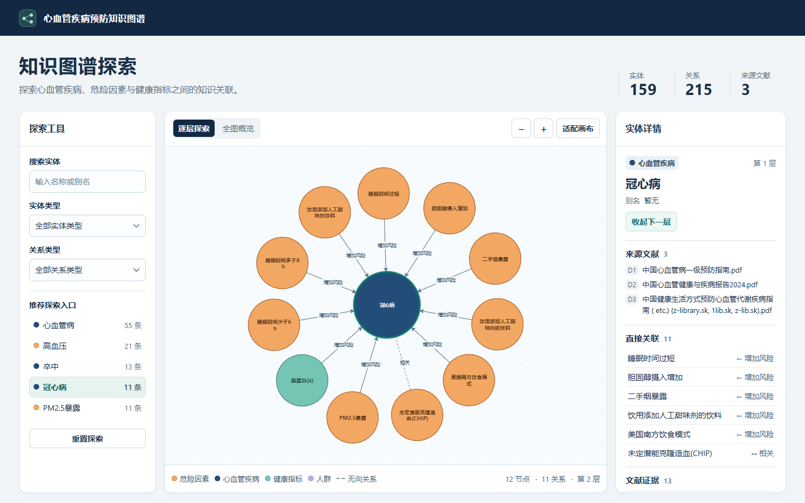
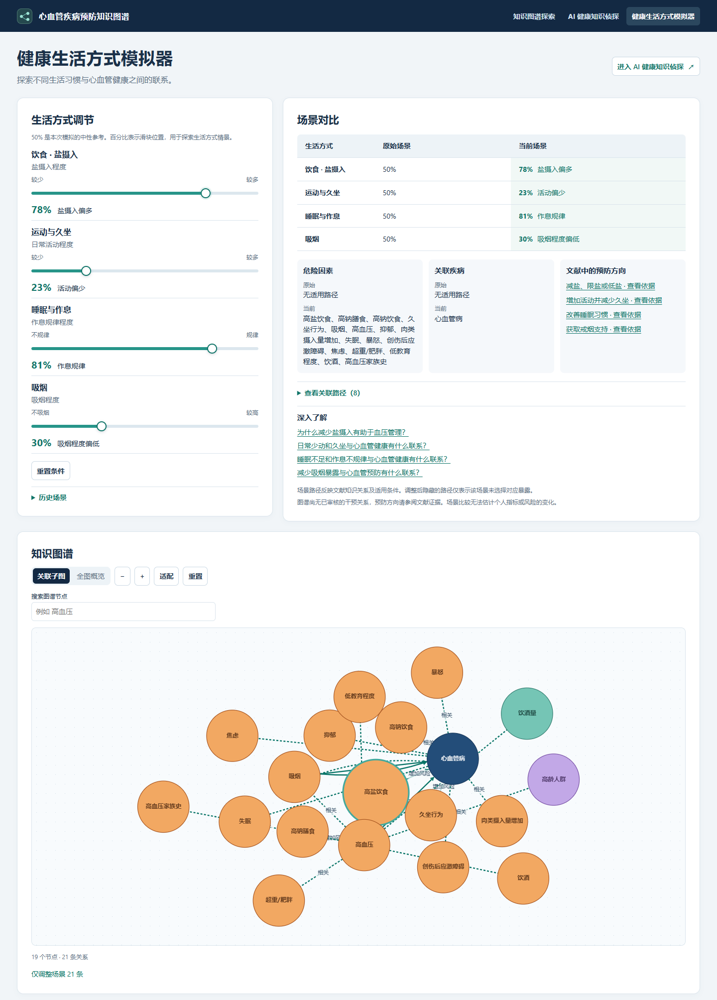
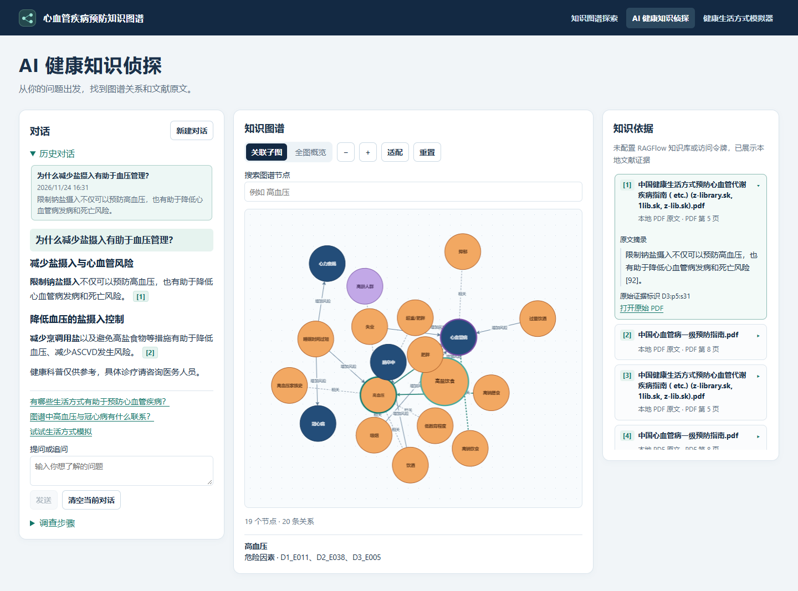
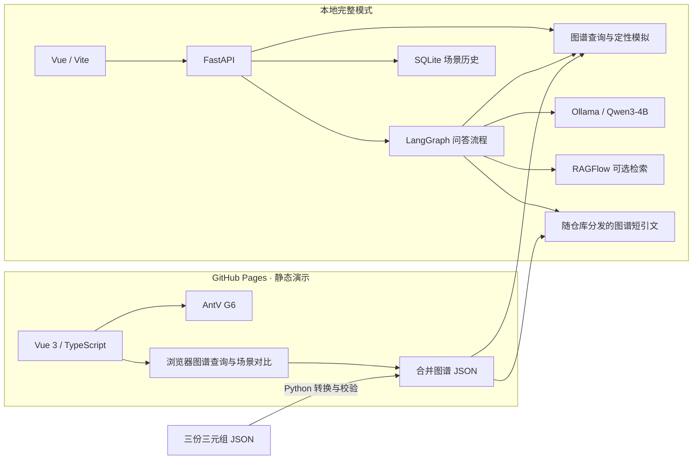

<div align="center">

# CVD-PKG

### Cardiovascular Disease Prevention Knowledge Graph

心血管疾病预防知识图谱与智能健康探索平台

[在线演示](https://cosmicdust17.github.io/CVD-PKG/) ·
[本地启动](#本地启动) ·
[数据来源](#图谱数据与来源) ·
[报告问题](https://github.com/cosmicdust17/CVD-PKG/issues)

[](https://github.com/cosmicdust17/CVD-PKG/actions/workflows/deploy.yml)

</div>

CVD-PKG 聚合三份中文心血管文献中的概念、关系和短摘录。读者可以从一个疾病、危险因素或生活方式开始，沿图谱查看相邻概念、关系方向、适用条件和来源。本地运行时，AI 健康知识侦探还可结合图谱查询、文献检索和本机模型生成带引用的科普解释。

| 功能 | GitHub Pages 在线演示 | 本地完整模式 |
| --- | --- | --- |
| 知识图谱探索 | 实体与别名搜索、逐层展开、关系与证据查看 | 同左 |
| AI 健康知识侦探 | 可搜索和展开图谱节点 | 自然语言提问、多轮追问、文献检索、Qwen 分析与引用 |
| 健康生活方式模拟器 | 连续滑块、场景对照、知识路径与 G6 联动 | 增加文献依据、AI 解释、场景历史和独立风险评分 |

滑块百分比表示交互位置。场景比较用于了解图谱中与所选暴露相关的知识路径。应用面向健康科普，临床判断应交由医务人员。

## 运行截图

**知识图谱探索**　从一个实体出发，按文献中的关系逐层展开。



**健康生活方式模拟器**　调节盐摄入、日常活动、作息和吸烟场景，查看关联路径。



**AI 健康知识侦探 · 本地模式**　右侧证据卡与回答中的引用编号及中间图谱联动。



## 技术架构



前端使用 Vue 3、TypeScript、Vite、AntV G6、markdown-it 和 DOMPurify。后端使用 Python、FastAPI、LangGraph、SQLite 和 PyCVDRisk。Ollama 提供本机模型服务，RAGFlow 可接入已有索引库。

## 图谱数据与来源

| 来源 | 三元组 JSON | 实体 | 关系 | 引文 |
| --- | --- | ---: | ---: | ---: |
| [中国心血管病一级预防指南](https://csc.cma.org.cn/art/2020/12/25/art_619_36880.html) | [D1](output/primary-prevention-triples/triples.json) | 53 | 59 | 37 |
| [中国心血管健康与疾病报告 2024](https://www.nccd.org.cn/Sites/Uploaded/File/2025/12/%E4%B8%AD%E5%9B%BD%E5%BF%83%E8%A1%80%E7%AE%A1%E5%81%A5%E5%BA%B7%E4%B8%8E%E7%96%BE%E7%97%85%E6%8A%A5%E5%91%8A2024.pdf) | [D2](output/cardiovascular-report-2024-triples/triples.json) | 107 | 140 | 99 |
| [中国健康生活方式预防心血管代谢疾病指南](https://doi.org/10.3760/cma.j.cn115624-20200209-00045) | [D3](output/healthy-lifestyle-triples/triples.json) | 20 | 19 | 15 |
| [合并图谱](kg-visualization/public/data/graph-data.json) | 供 G6 和 FastAPI 共用 | 159 | 215 | 151 |

图谱保留源实体 ID、关系 ID、文献 ID、PDF 物理页及已有引用。引用页码对应原项目使用的 PDF 版本，其他版本的页次可能有差异。Pages 同时提供 [D1](https://cosmicdust17.github.io/CVD-PKG/data/sources/primary-prevention.json)、[D2](https://cosmicdust17.github.io/CVD-PKG/data/sources/cardiovascular-report-2024.json) 和 [D3](https://cosmicdust17.github.io/CVD-PKG/data/sources/healthy-lifestyle.json) 的 JSON 下载。

## 目录

```text
CVD-PKG/
├── kg-visualization/   Vue 界面、G6、构建脚本和前端测试
├── hfkg/               FastAPI、图谱查询、文献检索和抽取工具
├── output/             三份独立三元组 JSON
├── config/             图谱、文献和后端环境变量示例
├── schema/             JSON 结构校验
├── deployment/         可选的本地 RAGFlow 部署脚本
├── tests/              后端测试
├── docs/screenshots/   真实运行截图
└── .github/workflows/  GitHub Pages 发布工作流
```

## 本地启动

Windows PowerShell 示例。需要 Python 3.12、Node.js 20.19+（Node 22 需 22.12+）、pnpm 12.3.4。要启用生成式解读，还需安装 [Ollama](https://docs.ollama.com/windows)。

```powershell
git clone https://github.com/cosmicdust17/CVD-PKG.git
cd CVD-PKG
python -m venv .venv
.\.venv\Scripts\python.exe -m pip install -r requirements-health.txt
```

**终端 1 · Ollama。** 若 Ollama 已在后台运行，直接执行模型下载。

```powershell
ollama serve
```

服务启动后，在另一个终端运行：

```powershell
ollama pull qwen3:4b
```

**终端 2 · FastAPI。** 从仓库根目录运行。仅体验图谱和证据检索时，可先设置 `$env:LLM_ENABLED = '0'`。

```powershell
.\.venv\Scripts\python.exe -m uvicorn hfkg.health_api:app --host 127.0.0.1 --port 8088
```

示例参数在 [config/health.env.example](config/health.env.example)。将需要调整的值设置到启动 FastAPI 的进程环境。默认模型为 `qwen3:4b`，Ollama 地址为 `http://127.0.0.1:11434`。模拟器首次保存历史时会自动创建 `data/health-history.sqlite3`，也可通过 `HF_HISTORY_DB` 指定绝对路径。对话保存在当前浏览器。启动后可打开 [FastAPI 接口文档](http://127.0.0.1:8088/docs)。

**终端 3 · Vue。** Vite 默认将 `/api` 代理到本机 8088。

```powershell
cd kg-visualization
pnpm install --frozen-lockfile
pnpm dev
```

打开 [本地站点](http://127.0.0.1:5187/)。修改三元组 JSON 后，可在同一目录运行 `python scripts/build_graph_data.py` 重新生成合并图谱。

### 接入真实文献

- **RAGFlow 可选。** 复用已完成解析和索引的知识库。在后端进程设置 `RAGFLOW_BASE_URL`、逗号分隔的 `RAGFLOW_DATASET_IDS` 与 `RAGFLOW_API_KEY`。现有 Python 客户端要求回环地址，默认 API 端口 19380。也可按 [RAGFlow HTTP API](https://ragflow.io/docs/v1.0.0-rc2/http_api_reference) 准备本机服务。
- **不配置 RAGFlow 时**，默认检索图谱内的已核验短引文。若持有原始文献，可将 PDF 放到 `documents/D1.pdf` 等相应位置，或修改 [config/documents.json](config/documents.json)，以启用原始 PDF 跳转。全文回退另外需要按 `hfkg/pdf_audit.py` 生成本地 PDF 页索引。

## GitHub Pages

[发布工作流](.github/workflows/deploy.yml) 在 `main` 更新时运行，也支持 Actions 手动触发。它从三份源 JSON 重建合并图谱，按 pnpm 锁文件安装依赖，执行测试后以 `/CVD-PKG/` 为 Vite 基路径构建，最后上传并部署静态产物。仓库 [Pages 设置](https://github.com/cosmicdust17/CVD-PKG/settings/pages) 的发布源为 **GitHub Actions**。

页面使用 `#graph`、`#detective` 和 `#simulator` 访问各入口。Pages 演示只执行客户端图谱和定性场景功能。AI 推理、RAGFlow 和关系检索外的后端功能通过本地模式使用。密钥由后端进程读取。

## 权属说明

项目代码暂未声明开源许可证。第三方依赖遵循各自的许可证。医学文献与摘录的权属归相应出版方或作者，完整 PDF 和全文索引由使用者自行准备。
